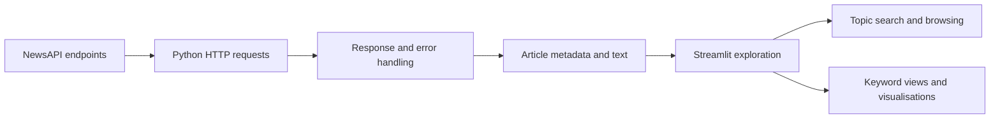

# AI News Automator: News Discovery and Analytics Dashboard

> A Python and Streamlit application that retrieves news articles through NewsAPI, supports category and keyword browsing, and provides interactive views of the results.

**Status:** Interactive application and API integration code available. Automated scheduling, generative AI analysis and production deployment are not independently verified.  
**Technologies:** Python, Streamlit, Requests, pandas, Plotly, python-dotenv.

## Executive Summary

Keeping track of developments across multiple news topics involves searching sources, filtering articles and reviewing information efficiently. This project demonstrates an API-connected news discovery interface that combines news retrieval with interactive presentation.

The repository contains a command-line retrieval script, `news_automator.py`, and a larger Streamlit application, `streamlit_enhanced_app.py`. The application supports interactive browsing and search, and includes keyword-oriented analysis and visualisation code. The project title refers to the intended AI and automation direction; it does not establish that articles are summarised by a trained or generative language model.

## Problem and Objectives

The project addresses the practical challenge of making topical news easier to browse and inspect. Objectives include:

1. Retrieve news through documented API endpoints.
2. Filter articles by categories and search terms.
3. Present article metadata and links in an interactive dashboard.
4. Explore simple keyword and content patterns.
5. Handle missing credentials, empty responses and API failures appropriately.
6. Establish a foundation for later automated summaries or scheduled workflows.

## Data Source and Architecture

The implementation uses [NewsAPI](https://newsapi.org/) for headline and article search endpoints. Results reflect NewsAPI coverage, rate limits, plan restrictions and publication metadata, rather than guaranteed complete or instant coverage.



## Implemented Components

| File | Purpose |
| --- | --- |
| `news_automator.py` | Command-line headline retrieval and article-link printing |
| `streamlit_enhanced_app.py` | Interactive dashboard using the NewsAPI service |
| `requirements.txt` | Python package requirements |
| `screenshots/image1.png` | Existing application screenshot |
| `PROFILE.md` | Project profile information |

The command-line script retrieves US top headlines by category. It also defines article-query and source helper functions. The Streamlit application contains separate category and keyword retrieval functions, alongside presentation and keyword processing code.

## Application Preview


This screenshot illustrates the repository's user interface. It should not be interpreted as evidence of a production deployment or automatically updated articles.

## Running the Application

```bash
git clone https://github.com/TeslimAdeyanju/AI-News-Automator.git
cd AI-News-Automator
python3 -m venv .venv
source .venv/bin/activate
python -m pip install -r requirements.txt
```

Create a local `.env` file with a valid NewsAPI key:

```dotenv
API_KEY=your-newsapi-key
```

Start the dashboard:

```bash
streamlit run streamlit_enhanced_app.py
```

For category retrieval from the command line:

```bash
python news_automator.py technology
```

Keep API keys out of Git and check service usage restrictions. The current setup has not been independently executed in this documentation revision.

## Analytics Scope and Evidence

The application can analyse or visualise information from retrieved article metadata and text. However, this is not the same as a validated NLP classifier, generative summariser or fact-checking system. No reproducible accuracy benchmark or deployment uptime result has been established.

## Repository Structure

```text
README.md
PROFILE.md
news_automator.py
streamlit_enhanced_app.py
requirements.txt
screenshots/
    image1.png
docs/
    legacy-readme.md
```

## Limitations

- NewsAPI source coverage and update timing depend on its subscription and provider restrictions.
- Search results may include duplicates, incomplete descriptions and articles lacking full text.
- Keyword matching and visualisations should not be interpreted as verified sentiment or article relevance.
- The title includes "Automator", but there is no demonstrated scheduled ingestion or notification service in this repository.
- The title includes "AI", but no independently verified LLM-powered processing should be assumed.
- Network reliability, API quotas, caching, response validation and tests need review before production use.
- Article copyright and news-provider terms limit redistributing full text.

## Future Development

1. Add stronger error and quota handling with explicit caching policies.
2. Add deduplication, source filters and freshness labels.
3. Implement reproducible topic or sentiment classification with human-reviewed tests.
4. Introduce optional LLM-based summaries with source references and quality evaluation.
5. Add scheduling only after reliable and compliant ingestion is established.
6. Create automated tests and deployment guidance for a supported hosting platform.

## Responsible Use

A news discovery application helps locate and organise articles; it does not certify the accuracy, completeness or neutrality of those articles. Verify important information against original sources.

## Author

**Teslim Adeyanju**  
[GitHub](https://github.com/TeslimAdeyanju) | [Portfolio](https://adeyanjuteslim.co.uk) | [LinkedIn](https://www.linkedin.com/in/adeyanjuteslimuthman)

[Original README archive](docs/legacy-readme.md)
